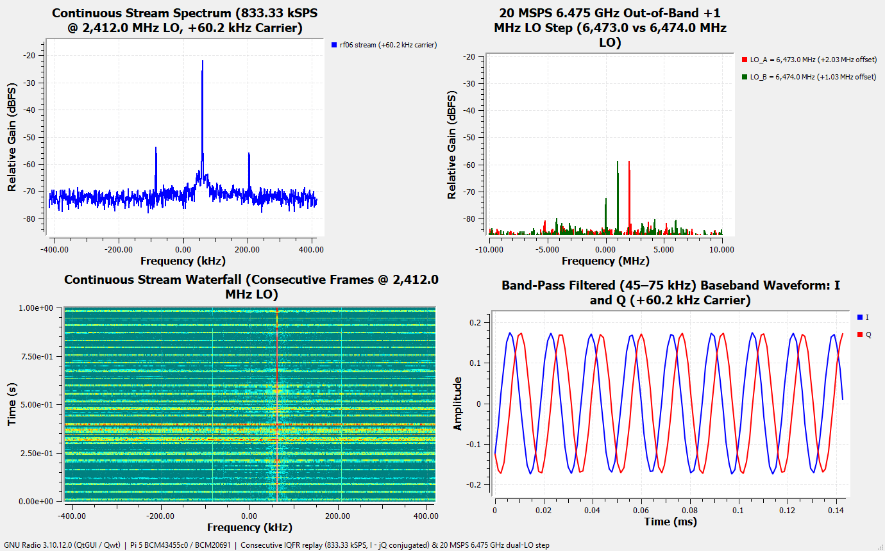

# Pi 5 Wi-Fi SDR

A Raspberry Pi 5 can operate its onboard Wi-Fi chip as an experimental, uncalibrated software-defined radio receiver, streaming about 833,000 selected complex radio samples per second for an hour (`3,000,238,080` samples) or capturing 200 µs bursts at 80 MSPS. The chip has a diagnostic collector for short captures; modified firmware and a Linux driver read completed blocks to the host while the collector keeps running. Across discrete tuning tests, the receiver tracked test signals at local-oscillator settings from 2,220–3,001 MHz and 4,748–6,474 MHz. In a separate short capture, the same Wi-Fi chip received an over-the-air Bluetooth LE packet that passed 24-bit CRC verification after software demodulation.



*Replay of saved Pi captures in GNU Radio 3.10.12.0 (`qtgui` / `Qwt`, with `I/Q` conjugated as `I - jQ` for display). Left: spectrum and consecutive-frame waterfall of the 833.33 kSPS continuous stream at `2,412.0 MHz` LO showing a narrow `+60.2 kHz` test carrier and intermittent broadband activity. Top right: two separate 20 MSPS captures of a `6,475.0 MHz` test signal (the signal generator's second harmonic) shifting by `-1.00 MHz` (`+2.03 MHz` to `+1.03 MHz`) when the requested LO steps from `6,473.0` to `6,474.0 MHz`. Bottom right: `45–75 kHz` band-pass filtered `I` and `Q` waveform of the `+60.2 kHz` carrier.*

## What this project achieves

The Broadcom BCM43455c0 contains an internal diagnostic collector that records complex baseband I/Q samples into shared device RAM. The published 20 MSPS and 80 MSPS snapshot experiments used the stock Linux driver with manufacturing-test firmware, which halts collection after a single buffer fills. The continuous stream used modified firmware and a modified `brcmfmac` SDIO driver that keep the collector running with a weighted six-input selection operation and expose framed `IQFR` records to user space through `debugfs`. [Implementation appendix](paper/implementation-appendix.md)

| Capture mode | Measured on the Pi |
| --- | --- |
| 2.4 GHz continuous stream | One hour (`3,600 s`) at 833,333 selected complex samples/s on `2,412 MHz` (`2,929,920` consecutive `IQFR` frames / `3,000,238,080` samples) using the modified firmware and `debugfs` driver. [Recording results](docs/current-findings.md) |
| 5 GHz continuous stream | `10.904 s` at 769,231 selected complex samples/s on `5,200 MHz` (`8,192` consecutive `IQFR` frames / `8,388,608` samples) using the modified firmware and `debugfs` driver. [Recording results](docs/current-findings.md) |
| 80 MSPS and 20 MSPS snapshots | 16,000 complex I/Q samples per snapshot (`200 µs` at 80 MSPS; `800 µs` at 20 MSPS, stored as signed 16-bit I/Q pairs) using the stock Linux driver with manufacturing-test firmware. The Bluetooth LE decode used a 20 MSPS snapshot. [RF measurements](docs/rf-characterization-20261121.md) |
| Discrete PLL probe sweeps | High band: seven of eleven tested LO pairs tracked the source, with passing settings from 4,748 to 6,474 MHz and four failing edge pairs. Low band: six of nine tested LO pairs tracked the source, with passing settings from 2,220 to 3,001 MHz and three failing edge pairs. Continuous coverage between tested points remains unverified. [High-band sweep](docs/lo-pair-sweep-20261122.md) · [Low-band sweep](docs/part2-rf-capabilities-20261121.md#2-out-of-band-fractional-n-pll-tuning-22203001-mhz-spot-map--6-ghz-wi-fi-6e-reception) |

## GNU Radio and SDR client integration

An [`rtl_tcp`-compatible network bridge](tools/pi5_rtltcp/README.md) (`tools/pi5_rtltcp`) streams I/Q samples at the fixed upstream capture frequency and sample rate over TCP port `1234` in `cu8` (standard 8-bit RTL-SDR, with per-frame DC offset removal and `I - jQ` conjugation) or `cs16` (headerless signed 16-bit `I - jQ` for a GNU Radio TCP Source block). The companion [spectrum and BLE analyzer](tools/pi5_specan/README.md) (`tools/pi5_specan`) combines snapshots from selected channels in the 2.4 and 5 GHz Wi-Fi bands. [Integration guide](docs/tools-specan-rtltcp.md)

## Verification

- **One-hour continuous stream audit:** A 3,600-second continuous capture at 833.33 kSPS delivered `2,929,920` consecutive 1,024-sample `IQFR` frames (`3,000,238,080` selected complex samples) with contiguous frame sequence numbers and verified 32-bit word-wise FNV payload checksums. [Recording results](docs/current-findings.md)
- **Over-the-air Bluetooth Low Energy packet decode:** A 20 MSPS snapshot on Wi-Fi Channel 4 (`2,427.0 MHz` LO) recorded an ambient Bluetooth LE packet at `2,426.0 MHz` (BLE Advertising Channel 38, `-1.0 MHz` baseband offset) using the Pi 5 Wi-Fi chip as the sole radio receiver. A 16-byte BLE scan response (`SCAN_RSP`, Access Address `0x8E89BED6`) passed 24-bit CRC verification (`0x6280E6`) in software after GFSK demodulation and de-whitening. [Packet measurements](docs/rf-characterization-20261121.md)
- **Differential LO signal-generator sweeps:** Using an external MAX2871 synthesizer, paired captures tracked the source after a `1.0 MHz` local-oscillator step across seven of eleven tested high-band LO pairs (`4,748` to `6,474 MHz`) and six of nine tested low-band LO pairs (`2,220` to `3,001 MHz`). [High-band sweep](docs/lo-pair-sweep-20261122.md) · [Low-band sweep](docs/part2-rf-capabilities-20261121.md#2-out-of-band-fractional-n-pll-tuning-22203001-mhz-spot-map--6-ghz-wi-fi-6e-reception)
- **Offline verification and local demos (no Pi required):** With Python 3.11 or newer, verify all 11 `IQFR` frames in the synthetic recording and recompute all 80 predeclared chunk decisions (`min ON/OFF95 ratio = 26.733`) from the controlled-source experiment:

```sh
python tools/verify_frames.py examples/synthetic-frames.bin --expected-frames 11
python src/rf_step0/decisions.py
```

With NumPy installed, both browser dashboards run offline on synthetic data from a fresh clone:

```sh
python -m tools.pi5_radar.server --demo --port 8766
python -m tools.pi5_specan.server --demo --port 8055
```

The repository includes offline verification scripts, firmware and driver build recipes, client tools, and aggregate measurements; the full acquisition and recovery controller and raw ambient recordings are private, and hardware builds require a user-supplied manufacturer firmware binary. Interactive hardware plots are available in the [RF characterization charts](https://theoddsock.github.io/pi5-wifi-sdr/rf-characterization.html) and [Part 2 exploratory showcase](https://theoddsock.github.io/pi5-wifi-sdr/part2-showcase.html).

## Reproducing the hardware work

Capture mode alters normal Wi-Fi operation. See the [build and reproduction guide](docs/reproducing.md), [data availability](evidence/data-availability.md), and [known limitations](docs/limitations.md) before modifying a device.

[ESP-SDR](https://espargos.net/espsdr/) inspired this project. The [implementation appendix](paper/implementation-appendix.md) documents the Broadcom-specific firmware and driver modifications. Project direction by TheOddSock with [AI assistance](AI_ASSISTANCE.md).

[Illustrated overview](https://theoddsock.github.io/pi5-wifi-sdr/) · [Technical report](pi5-receive-stream.pdf) · [Changelog](CHANGELOG.md) · [Tagged releases](https://github.com/TheOddSock/pi5-wifi-sdr/releases) · [Licensing](LICENSING.md)
